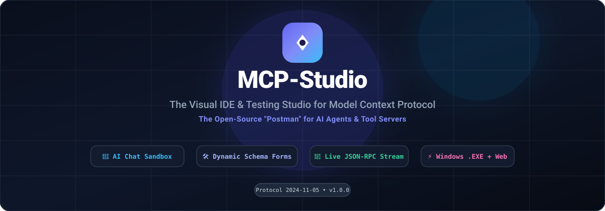
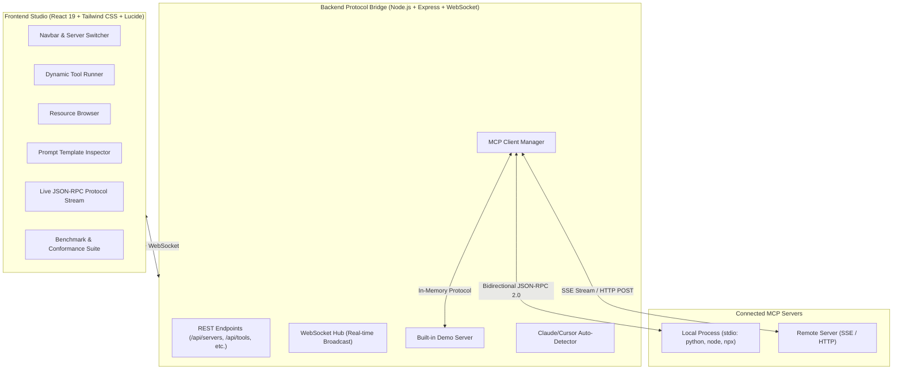
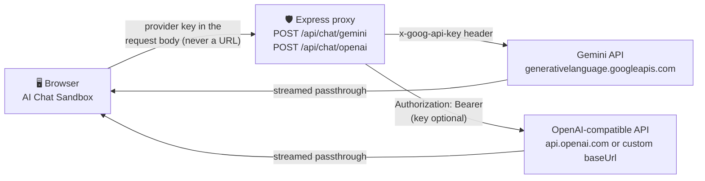

<div align="center">

# ⚡ MCP-Studio

### The Visual IDE & Testing Studio for Model Context Protocol (MCP) Servers
*The "Postman for MCP" — Connect, Inspect, Test, Benchmark, and Debug MCP Servers with Zero Friction.*

[](https://mohsen-niksirat.github.io/Mcp-Studio/)
[](https://github.com/mohsen-niksirat/Mcp-Studio/releases)

[](https://opensource.org/licenses/MIT)
[](https://github.com/mohsen-niksirat/Mcp-Studio/releases)
[](https://github.com/mohsen-niksirat/Mcp-Studio/actions/workflows/ci.yml)
[](https://codecov.io/gh/mohsen-niksirat/Mcp-Studio)
[](https://www.typescriptlang.org/)
[](https://react.dev/)
[](https://modelcontextprotocol.io/)
[](https://makeapullrequest.com)

[**Live Web Demo**](https://mohsen-niksirat.github.io/Mcp-Studio/) • [**Getting Started**](#-quick-start) • [**Features**](#-features) • [**Architecture**](#-architecture) • [**API**](#-rest-api-reference) • [**Testing**](#-testing) • [**Roadmap**](#-roadmap)

<br/>



</div>

---

## 💡 Why MCP-Studio?

Building [Model Context Protocol (MCP)](https://modelcontextprotocol.io/) servers in Python, TypeScript, or Go is transforming how AI applications interact with local tools, APIs, and data. However, developer experience has lagged behind:

- ❌ Testing tools required editing `claude_desktop_config.json` and restarting applications repeatedly.
- ❌ Official inspectors lack multi-server profile switching, execution history, and benchmark suites.
- ❌ Debugging raw JSON-RPC over `stdio` pipelines is opaque and error-prone.

**MCP-Studio** provides a unified, hyper-responsive visual workspace designed for developers who build, debug, and test MCP servers.

---

## ✨ Features

- 🤖 **AI Chat Sandbox**: Natural language agent interface supporting **Google Gemini**, **Ollama (local models)**, and OpenAI with automated function calling to test real-world tool execution.
- 📋 **Test Collections & Scenario Runner**: Define multi-step sequential test suites with output assertions, total latency measurement, and JSON export/import (the Postman Collections for MCP!).
- ⌨️ **Raycast-Style Command Palette (`Ctrl+K`)**: Instant fuzzy search across tools, workspaces, and actions from anywhere in the app.
- 💻 **1-Click Code Snippet Generator**: Instantly generate copy-pasteable integration code in **Python**, **TypeScript**, and **cURL** for any executed tool.
- 🔄 **Multi-Server Hot-Switching**: Manage multiple local (`stdio`: Python, Node, uvx, npx) and remote (`SSE`/HTTP) MCP servers in a single dashboard.
- 📥 **One-Click Config Importer**: Automatically detects and imports existing server configurations from **Claude Desktop** and **Cursor** (`claude_desktop_config.json`, `.cursor/mcp.json`).
- 🛠️ **Dynamic Schema Form Generator**: Parses tool JSON Schemas and automatically renders type-safe inputs (strings, numbers, enums, booleans, and nested JSON editors) with instant schema validation.
- ⚡ **Built-in Mock Playground**: Out-of-the-box demo server with math, system diagnostics, data generators, resources, and prompt templates — test the studio instantly without configuring any external server.
- 📦 **Resource Explorer & Parameterized Templates**: Browse exposed resources, inspect markdown/JSON content, and test parameterized resource URI templates (`{id}`, `{path}`).
- 💬 **Prompt Inspector**: View prompt templates, fill dynamic arguments, and preview generated AI conversation roles (`system`, `user`, `assistant`).
- 📡 **Live JSON-RPC Protocol Stream**: Real-time traffic monitor capturing every bidirectional JSON-RPC 2.0 frame with millisecond latency tracking, filtering, and one-click JSON copy.
- ⏱️ **Conformance & Latency Benchmark**: Automated multi-round handshake and latency benchmark suite with jitter analysis and success rate scoring.

---

## 🚀 Quick Start

### 1. Run via Source

```bash
# Clone the repository
git clone https://github.com/mohsen-niksirat/mcp-studio.git
cd mcp-studio

# Install dependencies with pnpm
pnpm install

# Start both backend and frontend concurrently
pnpm dev
```

Open your browser at **`http://localhost:5173`** (or **`http://localhost:4999`** in production).

### 2. Single Command Production Build

```bash
# Build production bundles
pnpm build

# Start production server
pnpm start
```

---

## 🏗️ Architecture



---

## 🛠️ Supported Transports

### 1. `stdio` (Subprocess)
Spawns local executable commands such as:
- `npx -y @modelcontextprotocol/server-filesystem C:\Path`
- `python server.py`
- `uvx mcp-server-git`
- `node dist/index.js`

### 2. `sse` (Server-Sent Events)
Connects to remote endpoints over HTTP streaming:
- `http://localhost:8000/sse`
- Custom auth headers supported.

---

## 🔐 Secure AI Chat Proxy

The AI Chat Sandbox never calls LLM providers from the browser. Every request
goes through the local backend (`server/src/chat/chat-proxy.ts`), which attaches
the provider key server-side and streams the answer straight back:



Hardening details:

- **Keys never appear in URLs** — the Gemini key is sent in the
  `x-goog-api-key` header instead of the `?key=` query parameter, so it cannot
  leak into proxies, logs, or browser history.
- **Model identifiers are validated** (`/^[A-Za-z0-9._-]+$/`) before being
  interpolated into the upstream URL, blocking path injection.
- **OpenAI-compatible endpoints are supported** — pass a custom `baseUrl`
  (must be `http(s)`) to target local gateways such as Ollama
  (`http://localhost:11434/v1`), which need no API key.
- **Responses stream through unbuffered**; upstream failures surface as
  `502` with a JSON error instead of hanging the connection.

---

## 🔌 REST API Reference

The backend listens on **`http://localhost:4999`** (in dev the Vite server
proxies `/api` and `/ws` on `:5173`). All errors return non-2xx status with a
JSON `{ "error": string }` body.

### Server registry

| Method | Endpoint | Description |
| --- | --- | --- |
| `GET` | `/api/servers` | List registered servers + current `activeState` |
| `POST` | `/api/servers` | Register a server (`name`, `transport`, plus `command`/`args`/`env` for stdio or `url`/`headers` for SSE) |
| `DELETE` | `/api/servers/:id` | Remove a registered server |
| `POST` | `/api/servers/:id/connect` | Connect and make it the active server |
| `POST` | `/api/servers/:id/reconnect` | Clean-session reconnect: disconnect the current active server, then connect `:id` fresh (crash recovery after `state:crashed`) |
| `POST` | `/api/servers/disconnect` | Disconnect the active server |
| `GET` | `/api/servers/active/state` | Current active-server state (status, server info, counts) |

### Active-server operations

| Method | Endpoint | Description |
| --- | --- | --- |
| `GET` | `/api/servers/active/tools` | `tools/list` from the active server |
| `POST` | `/api/servers/active/tools/call` | `tools/call` — body `{ name, arguments }` |
| `GET` | `/api/servers/active/resources` | `resources/list` |
| `POST` | `/api/servers/active/resources/read` | `resources/read` — body `{ uri }` |
| `GET` | `/api/servers/active/prompts` | `prompts/list` |
| `POST` | `/api/servers/active/prompts/get` | `prompts/get` — body `{ name, arguments }` |
| `POST` | `/api/servers/active/benchmark` | Multi-round handshake/latency benchmark — body `{ iterations }` (default 5) |

### System & import

| Method | Endpoint | Description |
| --- | --- | --- |
| `GET` | `/api/logs?limit=100` | Recent protocol/transport log lines |
| `DELETE` | `/api/logs` | Clear the log buffer |
| `GET` | `/api/import/detect` | Detect Claude Desktop / Cursor MCP configs on this machine |
| `POST` | `/api/import/apply` | Import detected servers — body `{ servers: [...] }` |
| `POST` | `/api/chat/gemini` | Secure Gemini proxy — body `{ apiKey, model?, payload }` |
| `POST` | `/api/chat/openai` | Secure OpenAI-compatible proxy — body `{ apiKey?, baseUrl?, payload }` |

### WebSocket (`/ws`)

The backend broadcasts real-time events to every connected client:

| Event | Fired when |
| --- | --- |
| `state:changed` | The active-server state changes (connect, disconnect, recovery) |
| `state:crashed` | The active stdio process dies unexpectedly |
| `log` | A protocol/transport log line is recorded |
| `notification` | A user-visible toast event occurs |
| `logs:cleared` | The log buffer is cleared |

---

## 🧪 Testing

The monorepo ships three test layers, all wired into CI:

| Layer | Command | Stack |
| --- | --- | --- |
| Backend unit | `pnpm --filter mcp-studio-server test` | `tsx` + `assert` — chat proxy, client manager (incl. crash resilience), mock server |
| Client unit | `pnpm --filter mcp-studio-client test` | Vitest + Testing Library |
| End-to-end | `pnpm --filter mcp-studio-e2e test` | Playwright — real backend + real browser |

Coverage runs the same suites under instrumentation and uploads lcov reports
to Codecov from CI (Node 22 leg):

```bash
pnpm --filter mcp-studio-server test:coverage   # c8
pnpm --filter mcp-studio-client test:coverage   # Vitest V8 coverage
```

The E2E suite starts both servers itself and covers three user journeys:
server management (incl. the Add Server modal), the tools runner (schema form →
`tools/call` → protocol inspector), and test collections (create, add a math
step with an assertion, run green). CI executes it on **chromium**; locally all
three browsers run — see [`e2e/README.md`](e2e/README.md) for browser notes and
the design constraints behind the serial execution.

---

## 🗺️ Roadmap

- [x] Multi-server switcher & connection status indicator
- [x] Dynamic Schema-to-Form generator
- [x] Built-in mock playground server
- [x] Auto-import from Claude Desktop & Cursor
- [x] Live JSON-RPC traffic streaming over WebSocket
- [x] Roundtrip latency benchmark suite
- [x] In-Browser Standalone Web Demo (GitHub Pages ready)
- [x] AI Chat Sandbox (Gemini, Ollama, OpenAI with automated function calling)
- [x] 1-Click Code Snippet Generator (Python, TypeScript, cURL)
- [x] Test Collections & Scenario Runner with assertions & JSON export
- [x] Raycast-style Command Palette (Ctrl+K)
- [x] Standalone Windows desktop package (.exe)
- [x] Secure server-side AI chat proxy (provider keys never in URLs)
- [x] Crash-resilient connections with a dedicated reconnect endpoint
- [x] Coverage reporting (c8 + Vitest) with Codecov badge
- [x] Playwright end-to-end suite in CI
- [ ] Direct LLM sampling sandbox (streaming server-initiated sampling)

---

## 🤝 Contributing

Contributions, issues, and feature requests are welcome!  
Feel free to check [issues page](https://github.com/mohsen-niksirat/mcp-studio/issues).

1. Fork the Project
2. Create your Feature Branch (`git checkout -b feature/AmazingFeature`)
3. Commit your Changes (`git commit -m 'Add some AmazingFeature'`)
4. Push to the Branch (`git push origin feature/AmazingFeature`)
5. Open a Pull Request

---

## 📄 License

Distributed under the MIT License. See `LICENSE` for more information.

---

<div align="center">
  Crafted with ❤️ by <a href="https://github.com/mohsen-niksirat">Mohsen Niksirat</a>
</div>
