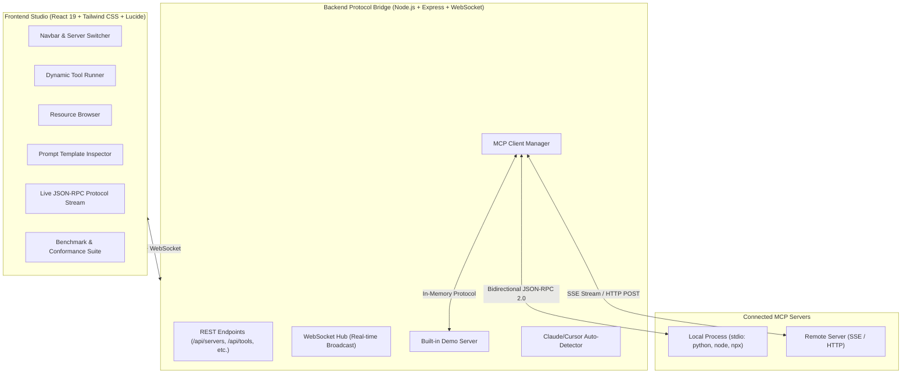

<div align="center">

# ⚡ MCP-Studio

### The Visual IDE & Testing Studio for Model Context Protocol (MCP) Servers
*The "Postman for MCP" — Connect, Inspect, Test, Benchmark, and Debug MCP Servers with Zero Friction.*

[](https://mohsen-niksirat.github.io/Mcp-Studio/)

[](https://opensource.org/licenses/MIT)
[](https://www.typescriptlang.org/)
[](https://react.dev/)
[](https://modelcontextprotocol.io/)
[](https://makeapullrequest.com)

[**Live Web Demo**](https://mohsen-niksirat.github.io/Mcp-Studio/) • [**Getting Started**](#-quick-start) • [**Features**](#-features) • [**Architecture**](#-architecture) • [**Roadmap**](#-roadmap)

</div>

---

## 💡 Why MCP-Studio?

Building [Model Context Protocol (MCP)](https://modelcontextprotocol.io/) servers in Python, TypeScript, or Go is transforming how AI applications interact with local tools, APIs, and data. However, developer experience has lagged behind:

- ❌ Testing tools required editing `claude_desktop_config.json` and restarting applications repeatedly.
- ❌ Official inspectors lack multi-server profile switching, execution history, and benchmark suites.
- ❌ Debugging raw JSON-RPC over `stdio` pipelines is opaque and error-prone.

**MCP-Studio** provides a unified, hyper-responsive visual workspace designed for developers who build, debug, and test MCP servers.

---

## ✨ Features

- 🤖 **AI Chat Sandbox**: Natural language agent interface supporting **Google Gemini**, **Ollama (local models)**, and OpenAI with automated function calling to test real-world tool execution.
- 🔄 **Multi-Server Hot-Switching**: Manage multiple local (`stdio`: Python, Node, uvx, npx) and remote (`SSE`/HTTP) MCP servers in a single dashboard.
- 📥 **One-Click Config Importer**: Automatically detects and imports existing server configurations from **Claude Desktop** and **Cursor** (`claude_desktop_config.json`, `.cursor/mcp.json`).
- 🛠️ **Dynamic Schema Form Generator**: Parses tool JSON Schemas and automatically renders type-safe inputs (strings, numbers, enums, booleans, and nested JSON editors) with instant schema validation.
- ⚡ **Built-in Mock Playground**: Out-of-the-box demo server with math, system diagnostics, data generators, resources, and prompt templates — test the studio instantly without configuring any external server.
- 📦 **Resource Explorer & Parameterized Templates**: Browse exposed resources, inspect markdown/JSON content, and test parameterized resource URI templates (`{id}`, `{path}`).
- 💬 **Prompt Inspector**: View prompt templates, fill dynamic arguments, and preview generated AI conversation roles (`system`, `user`, `assistant`).
- 📡 **Live JSON-RPC Protocol Stream**: Real-time traffic monitor capturing every bidirectional JSON-RPC 2.0 frame with millisecond latency tracking, filtering, and one-click JSON copy.
- ⏱️ **Conformance & Latency Benchmark**: Automated multi-round handshake and latency benchmark suite with jitter analysis and success rate scoring.

---

## 🚀 Quick Start

### 1. Run via Source

```bash
# Clone the repository
git clone https://github.com/mohsen-niksirat/mcp-studio.git
cd mcp-studio

# Install dependencies with pnpm
pnpm install

# Start both backend and frontend concurrently
pnpm dev
```

Open your browser at **`http://localhost:5173`** (or **`http://localhost:4999`** in production).

### 2. Single Command Production Build

```bash
# Build production bundles
pnpm build

# Start production server
pnpm start
```

---

## 🏗️ Architecture



---

## 🛠️ Supported Transports

### 1. `stdio` (Subprocess)
Spawns local executable commands such as:
- `npx -y @modelcontextprotocol/server-filesystem C:\Path`
- `python server.py`
- `uvx mcp-server-git`
- `node dist/index.js`

### 2. `sse` (Server-Sent Events)
Connects to remote endpoints over HTTP streaming:
- `http://localhost:8000/sse`
- Custom auth headers supported.

---

## 🗺️ Roadmap

- [x] Multi-server switcher & connection status indicator
- [x] Dynamic Schema-to-Form generator
- [x] Built-in mock playground server
- [x] Auto-import from Claude Desktop & Cursor
- [x] Live JSON-RPC traffic streaming over WebSocket
- [x] Roundtrip latency benchmark suite
- [x] In-Browser Standalone Web Demo (GitHub Pages ready)
- [x] AI Chat Sandbox (Gemini, Ollama, OpenAI with automated function calling)
- [ ] Exportable Postman-style test collections
- [ ] Standalone desktop package (Tauri / Electron)

---

## 🤝 Contributing

Contributions, issues, and feature requests are welcome!  
Feel free to check [issues page](https://github.com/mohsen-niksirat/mcp-studio/issues).

1. Fork the Project
2. Create your Feature Branch (`git checkout -b feature/AmazingFeature`)
3. Commit your Changes (`git commit -m 'Add some AmazingFeature'`)
4. Push to the Branch (`git push origin feature/AmazingFeature`)
5. Open a Pull Request

---

## 📄 License

Distributed under the MIT License. See `LICENSE` for more information.

---

<div align="center">
  Crafted with ❤️ by <a href="https://github.com/mohsen-niksirat">Mohsen Niksirat</a>
</div>
